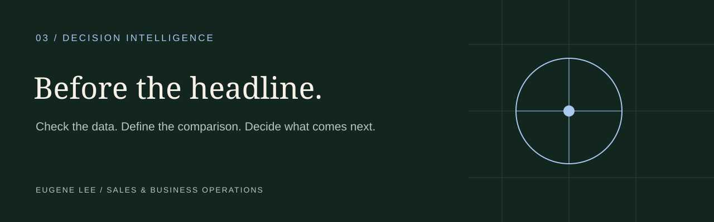

# Revenue Decision Dashboard
### 숫자를 보여주는 화면에서, 판단의 근거를 확인하는 화면으로.

[라이브 데모](https://leeyjn.github.io/revenue-decision-dashboard/) · [전체 프로젝트](https://github.com/leeyjn) · [분석 논리](ANALYSIS.md) · [공개 범위](PUBLICATION.md)

**Revenue operations · Metric definitions · Cohort analysis · Decision support**

## 왜 만들었나
성과가 내려갔다는 숫자만으로 원인을 알 수 없습니다. 원천 자료의 갱신이 멈췄을 수도 있고, 비교 주간에 구매가 몰린 하루가 포함됐을 수도 있습니다. 고객군이 달라졌거나 구매까지 걸리는 시간이 아직 지나지 않았을 수도 있습니다.

실제 업무에서는 매출·고객 행동·상담 신호를 함께 보고 다음 행동을 정해야 했습니다. 대시보드의 가치는 차트 개수보다 **성급한 해석을 막는 순서**에 있습니다.

## 실제 원본에서 확인한 설계
| 분석 층 | 확인한 구현·주석 | 이 판단이 중요한 이유 |
|---|---|---|
| 데이터 상태 | 최신 데이터 날짜, 헤더 변화, 행 한도 점검 | 수집 실패를 고객 활동 감소로 읽지 않기 |
| 지표 정의 | 결제액·환불·순액 구분, 일별 합계와 요약 값 대조 | 같은 ‘매출’이라는 이름에 다른 숫자를 섞지 않기 |
| 비교 기준 | 달력 기간과 판매 일정에 따른 귀속 예외 구분 | 다음 달로 넘어간 구매일 때문에 비교가 왜곡되지 않기 |
| 고객군 분리 | 가입 코호트, 첫 구매·재구매, 환불 후 상태 구분 | 전체 평균으로 서로 다른 행동을 덮지 않기 |
| 원인 후보 | 특정 하루 집중도, 가입→구매 시차, 사용 지속 여부 | 관찰된 동반 변화와 원인을 구분하기 |
| 실행 연결 | 연락 대상·제외 조건·담당자별 후속 목록 | 보고가 실제 행동으로 이어지게 하기 |

## 공개 데모
이 저장소의 화면은 **새로 디자인한 합성 데이터 데모**입니다. 회사 대시보드의 실제 화면이나 성과를 공개한 것이 아닙니다.

```sh
python -m http.server 8000
# 브라우저에서 http://localhost:8000
```

또는 `index.html`을 직접 열 수 있습니다. 금액/건수 카드와 분석 단계 버튼으로 계산 기준·해석·다음 행동을 확인합니다. 좁은 화면과 키보드 조작을 지원하며 외부 서비스에 연결하지 않습니다.

```sh
python metrics.py
python -m unittest discover -s tests -v
```

## 책임 범위와 한계
실제 업무 맥락은 직접 세일즈, 고객 운영, 팀 운영과 연결되어 있습니다. 공개 자료는 문제 정의·운영 기준·예외 처리와 AI 도구를 활용한 구현 방식을 보여주기 위해 재구성했습니다. 모든 코드를 혼자 수작업으로 작성했다거나, 대시보드 하나가 팀 매출 증가를 일으켰다는 주장은 하지 않습니다.

실제 시스템은 Sheets·BigQuery·CRM·Apps Script·정적 웹 화면을 연결합니다. 이 공개 예제는 지표 계약과 판단 구조만 보여주며 실시간 동기화·고객별 조회·발송·로그인을 제공하지 않습니다. 공개 예제의 중복 결제 거부와 일부 테스트는 검토 과정에서 새로 추가한 방어 규칙입니다.
